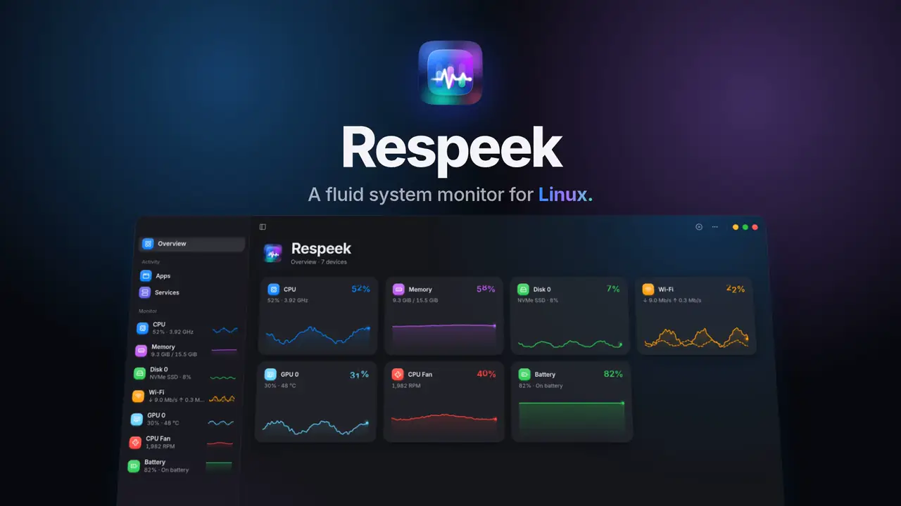
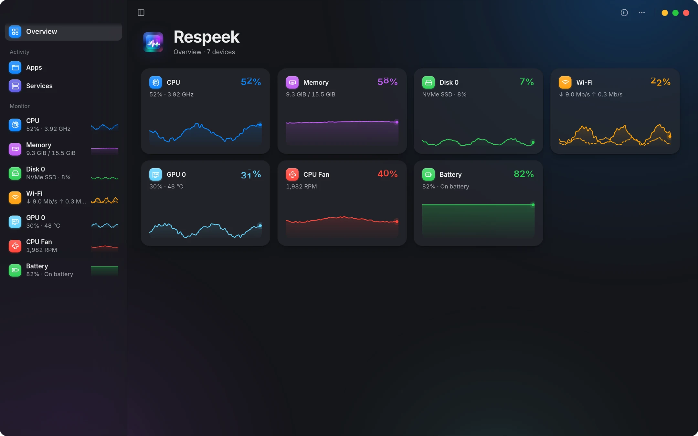
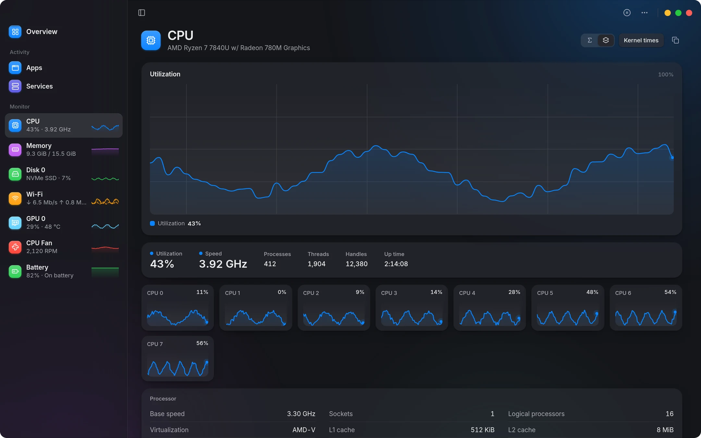
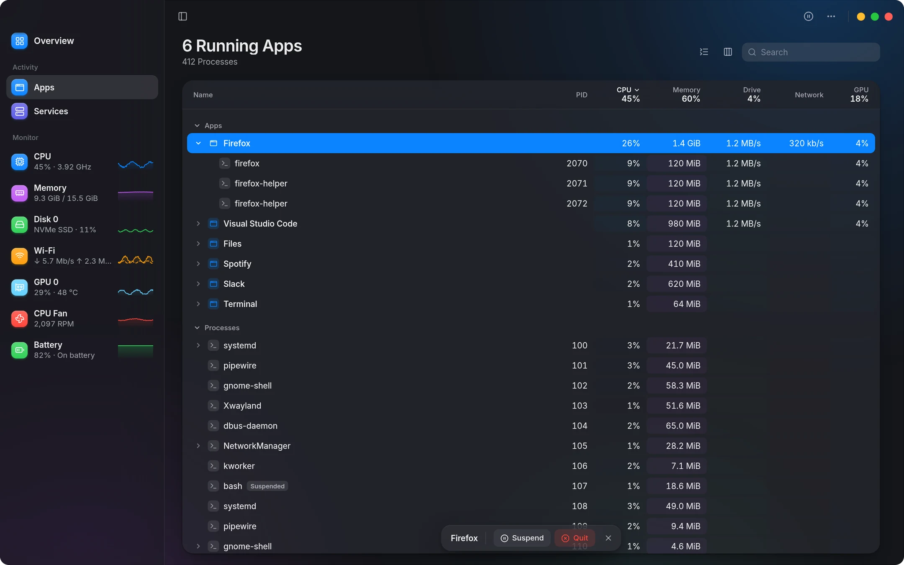
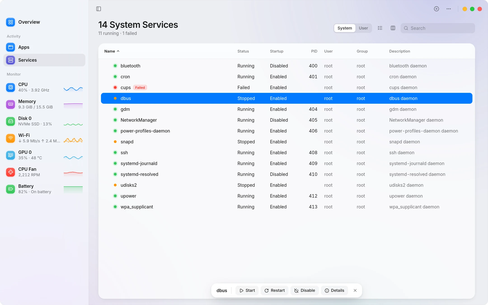
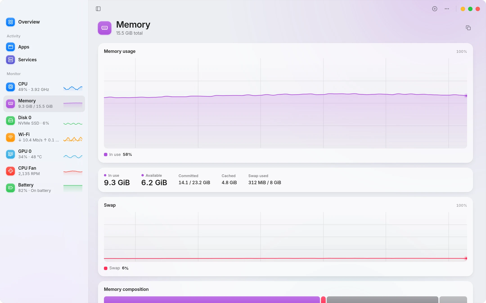
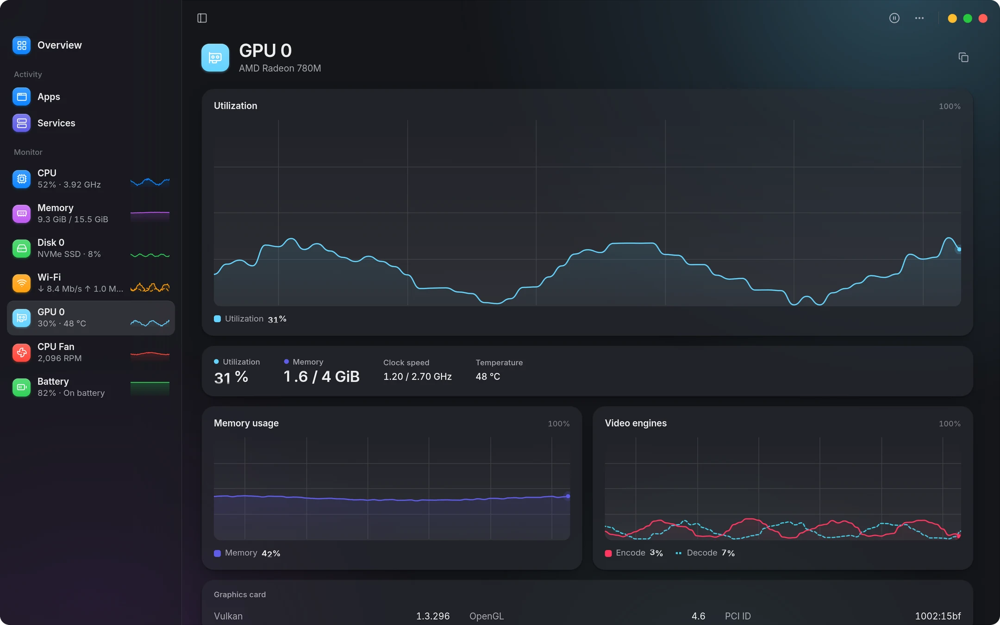
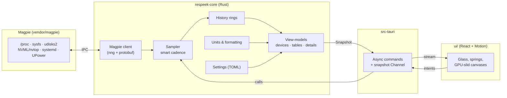

<div align="center">


# Respeek

**See everything your Linux machine is doing — beautifully.**

A fluid, glass-clear system monitor with Apple-grade motion, built on a Rust core.

<p>
  
  
  
  
  
  
</p>

<a href="media/respeek-launch.mp4">
  
</a>

<sub>▶ The preview above plays silently inline — <a href="media/respeek-launch.mp4"><b>open the full launch video with sound (MP4, 20 s, 1080p)</b></a>.</sub>

<br /><br />

[**Website**](https://jeevansai-k.github.io/respeek/) &nbsp;·&nbsp;
[**Download**](https://github.com/jeevansai-k/respeek/releases/latest) &nbsp;·&nbsp;
[**Build from source**](#-build-from-source) &nbsp;·&nbsp;
[**Architecture**](#-architecture) &nbsp;·&nbsp;
[**Shortcuts**](#%EF%B8%8F-keyboard-shortcuts)

</div>

---

## Contents

- [Why Respeek](#-why-respeek)
- [Feature tour](#-feature-tour)
- [Install](#-install)
- [Build from source](#-build-from-source)
- [Keyboard shortcuts](#%EF%B8%8F-keyboard-shortcuts)
- [Architecture](#-architecture)
- [Performance](#-performance)
- [Design principles](#-design-principles)
- [Configuration](#%EF%B8%8F-configuration)
- [Development](#-development)
- [Troubleshooting](#-troubleshooting)
- [Roadmap](#%EF%B8%8F-roadmap)
- [Contributing](#-contributing)
- [Credits & license](#-credits--license)

---

## ✨ Why Respeek

Most system monitors make you choose: **accurate** or **pleasant**. Respeek refuses to.

It keeps the battle-tested data engine of [Mission Center](https://gitlab.com/mission-center-devs/mission-center) — the **Magpie** gatherer and its client, both in Rust — and puts a new interface on top that behaves like it belongs on a modern desktop:

| | |
|---|---|
| 🪟 **Glass that means something** | Translucent sidebar, sheets and popovers over a soft colour field that follows the device you're viewing. |
| 🌀 **Motion you can feel** | Critically damped springs, interruptible transitions, pages that rise into place — measured at a locked **60 fps**. |
| 📈 **Graphs that glide** | Each sample is drawn once; the GPU slides it. Continuous motion at almost no CPU. |
| 🦀 **All logic in Rust** | Sorting, search, units, the app/process tree, every string on screen — the UI only renders. |
| 🔒 **Private by design** | No telemetry, no network calls, no accounts. Your data never leaves your machine. |

---

## 🧭 Feature tour

<table>
  <tr>
    <td width="50%"><br /><b>Overview</b> — every device in one calm grid.</td>
    <td width="50%"><br /><b>CPU</b> — overall or per-core, kernel time, clocks, caches, power.</td>
  </tr>
  <tr>
    <td><br /><b>Apps &amp; processes</b> — grouped tree, heat-tinted columns, instant search.</td>
    <td><br /><b>Services</b> — start, stop, restart, enable, disable, read logs.</td>
  </tr>
  <tr>
    <td><br /><b>Memory</b> — composition bar, swap, module slots.</td>
    <td><br /><b>GPUs</b> — integrated and discrete, VRAM, encoders, PCIe, APIs.</td>
  </tr>
</table>

**Everything Mission Center does, rebuilt:**

- **Performance** — CPU (overall / per-core, kernel times), memory & swap with composition, disks (active time, throughput, partitions, **S.M.A.R.T.**, **eject**), network (Wi-Fi details, addresses, dynamic scaling), GPUs, fans, batteries, plus an **Overview** of everything.
- **Apps & processes** — app → process tree or flat list, column chooser, sort, search, details sheet, suspend / resume / end / force quit / signals, with a macOS-style *Quit · Force Quit · Cancel* confirmation.
- **Services** — systemd user and system services with status, startup state and logs.
- **Preferences** — theme, six accents, reduce transparency, update interval, graph history, units (bits/bytes, base 2/10), sidebar devices & order, table behaviour.
- **Extras** — first-run welcome, *About This Computer*, keyboard shortcuts sheet, per-app network usage setup, hold-Ctrl-to-pause.

---

## 📦 Install

Grab the latest build from **[Releases](https://github.com/jeevansai-k/respeek/releases/latest)**.

**Debian / Ubuntu / Pop!_OS** (`.deb`)

```bash
sudo apt install ./Respeek_0.1.0_amd64.deb
```

**Any x86-64 distribution** (AppImage)

```bash
chmod +x Respeek_0.1.0_amd64.AppImage
./Respeek_0.1.0_amd64.AppImage
```

> The package ships the Magpie gatherer as a sidecar and its hardware-name database, so device names resolve out of the box.

---

## 🛠 Build from source

<details open>
<summary><b>1 · System dependencies (Debian / Ubuntu / Pop!_OS)</b></summary>

```bash
sudo apt install -y build-essential pkg-config libwebkit2gtk-4.1-dev libgtk-3-dev \
  librsvg2-dev libudev-dev libsystemd-dev libdbus-1-dev libgbm-dev libdrm-dev libxdo-dev
cargo install tauri-cli --version "^2"
```

Needs a recent stable **Rust** (tested with 1.100) and **Node** (tested with 22).
</details>

<details open>
<summary><b>2 · Build</b></summary>

```bash
git clone --recursive https://github.com/jeevansai-k/respeek
cd respeek
npm install
./scripts/build-magpie.sh     # builds the Magpie sidecar + hw.db
cargo tauri dev               # run with hot reload
cargo tauri build             # .deb + AppImage → target/release/bundle/
```
</details>

<details>
<summary><b>3 · Use a local build day-to-day (menu entry + dock icon)</b></summary>

```bash
cargo tauri build --no-bundle && ./scripts/install-local.sh
```

This installs `io.respeek.Respeek.desktop` and hicolor icons into `~/.local/share`. The window's GTK app id matches, so COSMIC, GNOME and KDE show the Respeek icon in the dock.
</details>

---

## ⌨️ Keyboard shortcuts

| Action | Keys | | Action | Keys |
|---|---|---|---|---|
| Performance / Apps / Services | <kbd>Ctrl</kbd> <kbd>1</kbd> / <kbd>2</kbd> / <kbd>3</kbd> | | Search | <kbd>Ctrl</kbd> <kbd>F</kbd> |
| Overview | <kbd>Ctrl</kbd> <kbd>M</kbd> | | Collapse all | <kbd>Ctrl</kbd> <kbd>L</kbd> |
| Select device | <kbd>F1</kbd> … <kbd>F8</kbd> | | Details | <kbd>Ctrl</kbd> <kbd>I</kbd> |
| Copy device info | <kbd>Ctrl</kbd> <kbd>C</kbd> | | Quit app / end process | <kbd>Ctrl</kbd> <kbd>E</kbd> |
| Toggle sidebar | <kbd>Ctrl</kbd> <kbd>T</kbd> | | Force quit | <kbd>Ctrl</kbd> <kbd>X</kbd> |
| Preferences | <kbd>Ctrl</kbd> <kbd>,</kbd> | | Start / stop / restart service | <kbd>Ctrl</kbd> <kbd>S</kbd> / <kbd>E</kbd> / <kbd>R</kbd> |
| About this computer | <kbd>Ctrl</kbd> <kbd>A</kbd> | | Move / expand / collapse | <kbd>↑</kbd> <kbd>↓</kbd> <kbd>→</kbd> <kbd>←</kbd> |
| Pause updates | hold <kbd>Ctrl</kbd> | | Quit Respeek | <kbd>Ctrl</kbd> <kbd>Q</kbd> |

---

## 🏗 Architecture



| Layer | Path | Responsibility |
|---|---|---|
| Gatherer | [`vendor/magpie`](vendor/magpie) | Mission Center's collector, unchanged (git submodule), shipped as a sidecar binary. |
| Core | [`crates/respeek-core`](crates/respeek-core) | **All logic**: client port, sampler & cadence, history, units, the app/process tree, search/sort, settings, every view-model. |
| Shell | [`src-tauri`](src-tauri) | Thin Tauri 2 bridge. Commands run off the UI thread; snapshots stream over one channel. |
| Interface | [`ui`](ui) | React + Motion. Renders view-models, sends intents — **no data processing**. |
| Website | [`site`](site) | Static marketing site, deployed to GitHub Pages. |

<details>
<summary><b>Repository layout</b></summary>

```text
respeek/
├── crates/respeek-core/     # Rust core (lib + respeek-dump debug tool)
│   └── src/{magpie/,engine,readings,devices,tables,details,model,units,settings,history,icons}.rs
├── src-tauri/               # Tauri shell, icons, desktop template, capabilities
├── ui/                      # React UI (src/components, pages, sheets, styles, dev/mock)
├── vendor/magpie/           # Mission Center gatherer (submodule)
├── scripts/                 # build-magpie.sh, install-local.sh, media tooling
├── site/                    # GitHub Pages website
├── branding/                # App icon source (SVG)
└── media/                   # Launch video + preview
```
</details>

---

## ⚡ Performance

Measured on an i7-13650HX laptop (Intel UHD + RTX 3050), release build, 1-second refresh:

| Metric | Result |
|---|---|
| Page transitions | **16.7 ms** average frame time, no dropped frames in steady state |
| UI process (WebKit) idle | **≈3–5 %** of one core |
| Rust shell idle | **≈1 %** of one core |
| Magpie gatherer idle | **≈4 %** of one core (expensive sensors back off when off-screen) |

<details>
<summary><b>How it stays fast</b></summary>

- **GPU-slid graphs** — each canvas is drawn once per sample, then translated by the compositor.
- **No main-thread commands** — every Tauri command is async, so clicks never block rendering.
- **Smart polling** — GPUs every 2nd tick, fans every 3rd, battery every 5th unless their page is open.
- **Compositor-only motion** — page transitions animate only `transform` and `opacity`; the ambient tint cross-fades pre-painted layers.
- **Memoized rows, isolated sidebar** — ticks re-render only what changed.

Reproduce the frame-timing numbers in the real WebKitGTK window:

```bash
VITE_PERF_TOUR=1 cargo tauri dev   # look for [perf] lines in the terminal
```
</details>

---

## 🎨 Design principles

Respeek follows Apple's *Designing Fluid Interfaces* playbook, translated to the web:

1. **Respond on press** — feedback starts on pointer-down.
2. **Interruptible everything** — no animation locks input; springs re-target from the on-screen value.
3. **Springs over curves** — `bounce: 0` by default; a touch of bounce only after a drag.
4. **Spatial consistency** — sheets grow from the row that opened them and return there.
5. **Materials with meaning** — heavy glass for structure, light glass for controls, never glass on glass.
6. **Accessible motion** — honours `prefers-reduced-motion`, `prefers-reduced-transparency` and `prefers-contrast`.

---

## ⚙️ Configuration

Settings live in `~/.config/respeek/settings.toml` and are editable from **Preferences**.

| Environment variable | Purpose |
|---|---|
| `RESPEEK_MAGPIE_PATH` | Use a specific Magpie binary. |
| `MC_MAGPIE_HW_DB` | Path to the hardware-name database (set automatically). |
| `WEBKIT_DISABLE_DMABUF_RENDERER=1` | Work around a blank window on some NVIDIA-only setups. |
| `RUST_LOG=respeek::timing=debug` | Log how long each Magpie request takes. |

---

## 🧑‍💻 Development

```bash
cargo test -p respeek-core                                   # core unit tests
npm run typecheck                                            # UI types
npm run dev                                                  # UI only, with a fixture backend at :1420
cargo run -p respeek-core --bin respeek-dump -- apps         # live snapshot as JSON
```

The browser-only fixture backend (`ui/src/dev/mock.ts`) lets you iterate on layout and motion without Magpie.

---

## 🩺 Troubleshooting

<details>
<summary><b>The window is blank</b></summary>

Launch with `WEBKIT_DISABLE_DMABUF_RENDERER=1 respeek`. This mostly affects NVIDIA-only Wayland setups.
</details>

<details>
<summary><b>No icon in the dock</b></summary>

Run `./scripts/install-local.sh` (local builds) — the `.deb` installs the desktop entry for you.
</details>

<details>
<summary><b>Per-app network usage shows nothing</b></summary>

Open **Preferences › Apps & Services** and run the one-time setup; it grants the capability Magpie needs.
</details>

<details>
<summary><b>Service PIDs appear after a moment</b></summary>

Magpie fills systemd properties asynchronously; they populate within a few refreshes.
</details>

---

## 🗺️ Roadmap

- [ ] Flatpak packaging
- [ ] Per-process GPU usage in the Apps table
- [ ] Mini "summary" floating window
- [ ] Localization (Mission Center's translations)
- [ ] ARM64 builds

---

## 🤝 Contributing

Issues and pull requests are welcome. Keep logic in `respeek-core` (the UI must stay a pure renderer), add a unit test for behaviour changes, and run `cargo test -p respeek-core && npm run typecheck` before opening a PR.

---

## 📜 Credits & license

Respeek is free software released under the **GNU General Public License v3.0 or later** — see [`COPYING`](COPYING).

Built on the Rust core of **[Mission Center](https://gitlab.com/mission-center-devs/mission-center)** — the Magpie gatherer and client — by the Mission Center developers. Thank you.

<div align="center">
<br />

<br />
<sub>Made with care for the Linux desktop.</sub>
</div>
